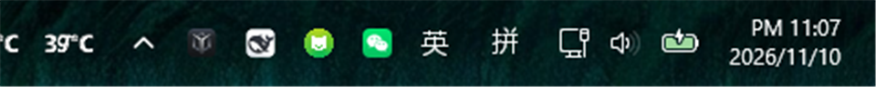
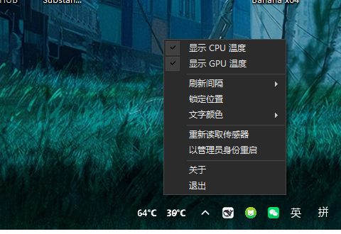

# TempBar

**把 CPU / GPU 温度以纯白文字直接贴在 Windows 任务栏上**——无背景、无边框、无面板，像系统自带的一部分。
单文件绿色版，1 MB，双击即用，退出自动清除所有痕迹。

[](https://github.com/china-wkz/TempBar/releases/latest)
[](https://github.com/china-wkz/TempBar/releases)

### ⬇️ 下载

**[→ 下载 TempBar.exe](https://github.com/china-wkz/TempBar/releases/latest)**（单文件，免安装，约 1 MB）

不想下载二进制？克隆仓库后执行 `.\build.ps1` 自行构建，见[构建](#构建)。



> 左边是 CPU，右边是 GPU。没有标签，因为看两次就记住了。



---

## 特性

- **极低占用**：CPU 占用低到测量噪声级别，常驻内存约 1～4 MB（实测数据见下）
- **真·透明**：分层窗口 + 预乘 alpha，只画文字，不画任何底色，任务栏壁纸原样透出来
- **单文件**：传感器库编译时嵌入 exe，运行时不依赖任何外部 DLL
- **零残留**：设置只存内存，退出时删除临时文件、内核驱动 `.sys` 与驱动服务
- **自适应**：0.5 秒重新置顶，任务栏重绘/点击不会把它盖掉；显示器分辨率变化自动重新定位
- **可拖动**：按住温度文字左右拖动，可以贴着时钟放，也可以拖到任务栏任意位置
- **关掉哪个就真不采哪个**：取消勾选 GPU，NVML 完全不加载；取消勾选 CPU，内核驱动直接卸载——不是只藏起来不显示

## 实测占用

测试机：Windows 11 · Ryzen 7 5800H · RTX 3060 Laptop · 2560×1440 · 默认 2 秒刷新

| 指标 | 实测值 |
| --- | --- |
| CPU 时间 | **31 ms / 60 s** = 单核 0.05% = 全核 **0.003%**（任务管理器显示 0%） |
| 内存（私有工作集） | **1.3 – 4.2 MB**（涨到阈值即回收，锯齿曲线属正常） |
| 内存（总工作集） | 3.5 – 7.9 MB |
| 线程 / 句柄 | 9 / ~410 |
| 文件 | 单个 exe，1.0 MB |

> "私有工作集"是任务管理器“内存”列显示的值，也就是真实占用的物理内存。
> “提交大小”约 45 MB，那是虚拟地址空间预留（NVML 驱动库映射），不占物理内存。

## 为什么能这么低

这不是靠省代码，而是靠四个关键取舍：

1. **GPU 走 NVML 直读** —— 直接 P/Invoke `nvml.dll` 的 `nvmlDeviceGetTemperature`，单次 0.05 微秒。
   常见的做法是调用通用硬件采集框架，而它光 GPU 子系统单次刷新就要 **70 ms、60 MB**。
2. **CPU 只用 LibreHardwareMonitor 的 CPU 子系统** —— 同一套框架的 GPU 模块被完全绕开，
   只保留读 MSR/SMN 需要的最小路径（单次约 0.3 ms）。
3. **工作集按需回收** —— GPU 驱动库会常驻约 20 MB，每次采样后按阈值调用 `EmptyWorkingSet`
   把页面交还系统，于是常驻内存稳定在 1 MB 级。
4. **只在数字变化时合成一帧** —— 界面是分层窗口（`UpdateLayeredWindow` + 32bpp 预乘 alpha 位图），
   文本没变就完全不重绘；UI 定时器与采样间隔对齐，避免一半唤醒是空转。

## 使用

| 操作 | 说明 |
| --- | --- |
| 双击 exe | 启动（首次会弹一次 UAC，见下） |
| 右键温度文字 / 左键托盘图标 | 打开菜单，点击空白处关闭 |
| 左键拖动 | 沿任务栏移动位置 |
| 显示 CPU / GPU 温度 | 只显示其中一个（**同时停止该传感器的采集**，不是仅仅隐藏） |
| 刷新间隔 | 1 / 2 / 3 / 5 秒（默认 2 秒） |
| 锁定位置 | 防止误拖动 |
| 文字颜色 | 自动跟随系统主题 / 强制白色 / 强制深色 |
| 重新读取传感器 | 睡眠唤醒后传感器异常时使用 |
| 退出 | 退出并清理痕迹 |

## 命令行参数

```
TempBar.exe --cpu-only       # 只监测 CPU：不加载 NVML，不碰显卡
TempBar.exe --gpu-only       # 只监测 GPU：不加载内核驱动，不需要管理员权限
TempBar.exe --noelevate      # 不请求提权（CPU 温度会显示 --°C）
```

`--gpu-only` 尤其适合不关心 CPU 温度的场景：它完全不加载内核驱动，也就不需要管理员权限。

## 关于 UAC

读 CPU 温度需要访问 MSR/SMN，这是内核操作，必须加载签名驱动，因此需要管理员权限。

- 绿色版**不做安装**，所以每次启动弹一次 UAC —— 这是“零残留”的直接代价；
- 在 UAC 点“否”程序仍会运行，此时 CPU 显示 `--°C`，GPU 温度不受影响；
- 若希望开机自启且永不弹 UAC，需要注册“最高权限计划任务”，但那会在系统里留下条目，与零残留冲突。

> 顺带解释一个常见误解：AIDA64 / HWiNFO “不需要管理员权限”，是因为它们在**安装时**就把签名驱动
> 注册成了服务，日常运行自然不会弹 UAC。绿色版没有安装步骤，只能在启动时请求一次。

## 构建

需要 **Visual Studio 2022**（或 Build Tools，含 .NET 桌面开发工作负载）、**Python 3**（生成图标）。

```powershell
git clone https://github.com/china-wkz/TempBar.git
cd TempBar
.\build.ps1
```

脚本会自动下载 [LibreHardwareMonitorLib](https://github.com/LibreHardwareMonitor/LibreHardwareMonitor)
与 [HidSharp](https://www.zer7.com/software/hidsharp) 到 `libs\`，生成多尺寸图标，编译并输出单文件
`dist\TempBar.exe`。

目标框架：**.NET Framework 4.8.1**（Windows 10/11 自带，无需安装运行时），x64。

## 目录结构

```
TempBar/
├── src/                  C# 源码
│   ├── WidgetForm.cs     分层窗口：透明文字绘制、拖拽、ULW 推送
│   ├── SensorService.cs  后台采样线程：LHM 读 CPU、NVML 读 GPU、工作集回收
│   ├── TempBarContext.cs 托盘图标、菜单、定时器、生命周期
│   ├── Cleanup.cs        退出清理：临时文件 / 驱动 .sys / 驱动服务
│   ├── Native.cs         P/Invoke 声明
│   └── ...
├── tools/
│   ├── fetch-libs.ps1    下载依赖库
│   └── genicon.py        生成多尺寸 .ico
├── docs/                 README 截图
├── assets/               图标源文件
└── build.ps1             一键构建
```

## 已知限制

- 仅 Windows 10 / 11（x64）；
- GPU 温度依赖 NVIDIA 驱动自带的 NVML，AMD / Intel 显卡暂不显示 GPU 温度；
- 全屏独占游戏时任务栏隐藏，温度随之不可见（与任务栏行为一致）；
- 依赖 LibreHardwareMonitor 的内核驱动读取 CPU 温度，若系统启用了“微软漏洞驱动阻止列表”，
  该驱动可能无法加载（届时 CPU 显示 `--°C`）。

## 许可

代码可自由使用与修改。
依赖：[LibreHardwareMonitorLib](https://github.com/LibreHardwareMonitor/LibreHardwareMonitor)（MIT）、
[HidSharp](https://www.zer7.com/software/hidsharp)（Apache-2.0）。
